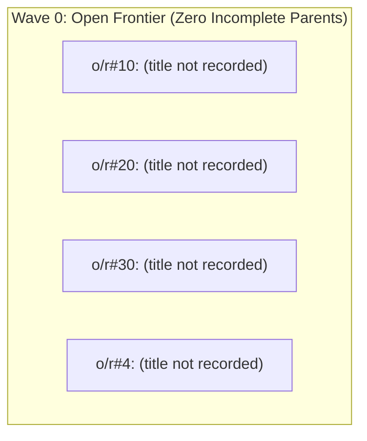

<!-- BEGIN GENERATED ISSUE DAG (taskalisk --emit-roadmap; do not edit by hand) -->

Compiled from issue frontmatter (`issue-dag/2`), home `o/r`, roots `o/r#9`. Artifact hash `86d29d06d4bbd755`. Regenerate with `taskalisk.py --from-github [--root <ref>] --emit-roadmap`.

## DAG Structural Health

| Metric | Value |
| --- | --- |
| Open nodes | 4 |
| Reduced edges (raw) | 0 (0) |
| Edge density | 0.0 (outside band 0.01–0.50) |
| Max parallel width | 4 |
| Critical path (1) | o/r#4 |
| Isolated nodes | 4 |
| Containers excluded | o/r#9, o/s#2, o/r#1 |

## Ranked Open Frontier (Wave 0)

| Rank | Score | Issue | Title | Status | Unblocks | Depth | Resources | Directly unlocks |
| ---: | ---: | --- | --- | --- | ---: | ---: | --- | --- |
| 1 | 10 | [o/r#10](https://github.com/o/r/issues/10) | (title not recorded) | blocked | 0 | 1 | — | — |
| 2 | 10 | [o/r#20](https://github.com/o/r/issues/20) | (title not recorded) | blocked | 0 | 1 | — | — |
| 3 | 10 | [o/r#30](https://github.com/o/r/issues/30) | (title not recorded) | open | 0 | 1 | — | — |
| 4 | 10 | [o/r#4](https://github.com/o/r/issues/4) | (title not recorded) | open | 0 | 1 | — | — |

### Conflict-Free git-locks Batch

- [o/r#30](https://github.com/o/r/issues/30) (title not recorded) — no resources
- [o/r#4](https://github.com/o/r/issues/4) (title not recorded) — no resources

## Task Checklist by Wave

### Wave 0

- [ ] [o/r#10](https://github.com/o/r/issues/10) (title not recorded) (blocked)
- [ ] [o/r#20](https://github.com/o/r/issues/20) (title not recorded) (blocked)
- [ ] [o/r#30](https://github.com/o/r/issues/30) (title not recorded) (open)
- [ ] [o/r#4](https://github.com/o/r/issues/4) (title not recorded) (open)

## Task Checklist by Workstream (`area:*`)

### feature

- [ ] [o/r#4](https://github.com/o/r/issues/4) (title not recorded)
- [ ] [o/r#30](https://github.com/o/r/issues/30) (title not recorded)

### unassigned

- [ ] [o/r#10](https://github.com/o/r/issues/10) (title not recorded)
- [ ] [o/r#20](https://github.com/o/r/issues/20) (title not recorded)

## Transitively-Reduced Dependency DAG

## Prerequisite Edge Accounting

| Blocker | Blocked | Evidence |
| --- | --- | --- |

<!-- END GENERATED ISSUE DAG -->