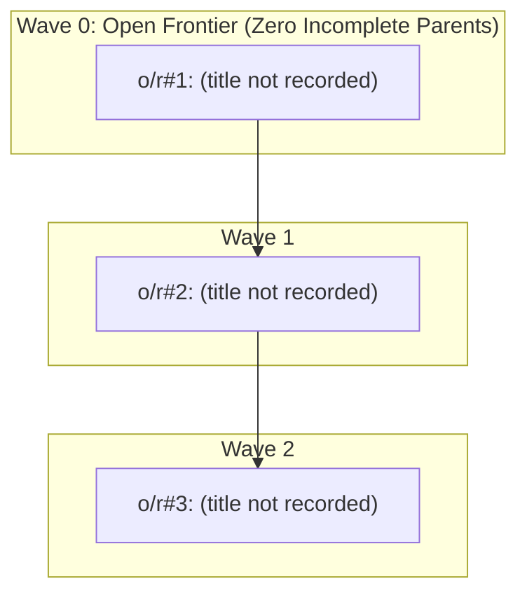

<!-- BEGIN GENERATED ISSUE DAG (taskalisk --emit-roadmap; do not edit by hand) -->

Compiled from issue frontmatter (`issue-dag/2`), home `o/r`, roots `o/r#3`. Artifact hash `25476d52c699f5e7`. Regenerate with `taskalisk.py --from-github [--root <ref>] --emit-roadmap`.

## DAG Structural Health

| Metric | Value |
| --- | --- |
| Open nodes | 3 |
| Reduced edges (raw) | 2 (3) |
| Edge density | 0.6667 (outside band 0.01–0.50) |
| Max parallel width | 1 |
| Critical path (3) | o/r#1 → o/r#2 → o/r#3 |
| Isolated nodes | 0 |
| Containers excluded | none |

## Ranked Open Frontier (Wave 0)

| Rank | Score | Issue | Title | Status | Unblocks | Depth | Resources | Directly unlocks |
| ---: | ---: | --- | --- | --- | ---: | ---: | --- | --- |
| 1 | 231 | [o/r#1](https://github.com/o/r/issues/1) | (title not recorded) | open | 2 | 3 | — | o/r#2 |

### Conflict-Free git-locks Batch

- [o/r#1](https://github.com/o/r/issues/1) (title not recorded) — no resources

## Task Checklist by Wave

### Wave 0

- [ ] [o/r#1](https://github.com/o/r/issues/1) (title not recorded) (open)

### Wave 1

- [ ] [o/r#2](https://github.com/o/r/issues/2) (title not recorded) (open)

### Wave 2

- [ ] [o/r#3](https://github.com/o/r/issues/3) (title not recorded) (open)

## Task Checklist by Workstream (`area:*`)

### feature

- [ ] [o/r#1](https://github.com/o/r/issues/1) (title not recorded)
- [ ] [o/r#2](https://github.com/o/r/issues/2) (title not recorded)
- [ ] [o/r#3](https://github.com/o/r/issues/3) (title not recorded)

## Transitively-Reduced Dependency DAG

## Prerequisite Edge Accounting

| Blocker | Blocked | Evidence |
| --- | --- | --- |
| o/r#1 | o/r#2 | frontmatter: o/r#2 .blocked_by o/r#1 |
| o/r#2 | o/r#3 | frontmatter: o/r#3 .blocked_by o/r#2 |

Recorded on GitHub but implied by a longer path (kept there as evidence, omitted from the reduced DAG):

- o/r#1 → o/r#3 (via o/r#2)

<!-- END GENERATED ISSUE DAG -->