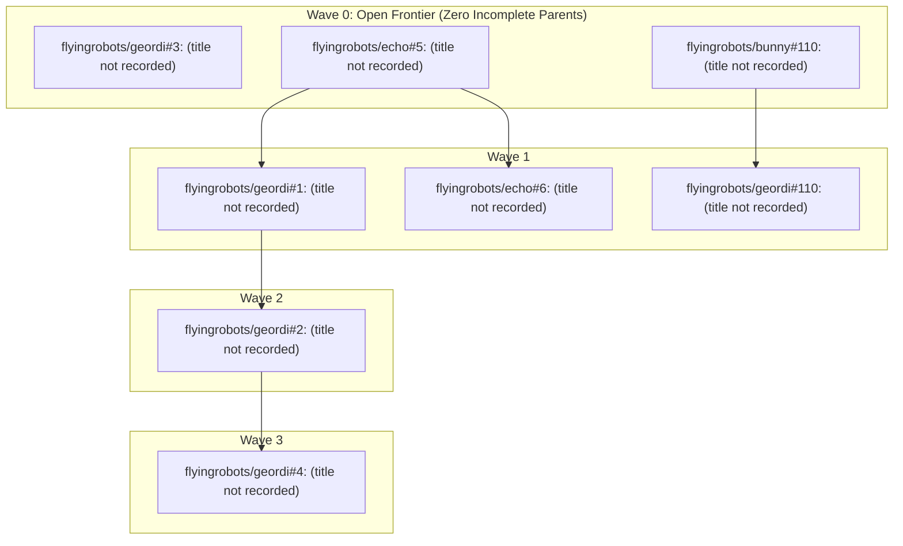

<!-- BEGIN GENERATED ISSUE DAG (taskalisk --emit-roadmap; do not edit by hand) -->

Compiled from issue frontmatter (`issue-dag/2`), home `flyingrobots/geordi`, roots `all open home issues`. Artifact hash `41c5a18a05711e45`. Regenerate with `taskalisk.py --from-github [--root <ref>] --emit-roadmap`.

## DAG Structural Health

| Metric | Value |
| --- | --- |
| Open nodes | 8 |
| Reduced edges (raw) | 5 (6) |
| Edge density | 0.1786 (in band 0.01–0.50) |
| Max parallel width | 3 |
| Critical path (4) | flyingrobots/echo#5 → flyingrobots/geordi#1 → flyingrobots/geordi#2 → flyingrobots/geordi#4 |
| Isolated nodes | 1 |
| Containers excluded | flyingrobots/geordi#9 |

## Ranked Open Frontier (Wave 0)

| Rank | Score | Issue | Title | Status | Unblocks | Depth | Resources | Directly unlocks |
| ---: | ---: | --- | --- | --- | ---: | ---: | --- | --- |
| 1 | 1010 | [flyingrobots/geordi#3](https://github.com/flyingrobots/geordi/issues/3) | (title not recorded) | wip | 0 | 1 | `docs/plans/`, `gpu*1` | — |
| 2 | 442 | [flyingrobots/echo#5](https://github.com/flyingrobots/echo/issues/5) | (title not recorded) | open | 4 | 4 | `docs/`, `gpu*1` | flyingrobots/echo#6, flyingrobots/geordi#1 |
| 3 | 121 | [flyingrobots/bunny#110](https://github.com/flyingrobots/bunny/issues/110) | (title not recorded) | blocked | 1 | 2 | — | flyingrobots/geordi#110 |

### Conflict-Free git-locks Batch

- [flyingrobots/geordi#3](https://github.com/flyingrobots/geordi/issues/3) (title not recorded) — `docs/plans/`, `gpu*1`

## Task Checklist by Wave

### Wave 0

- [ ] [flyingrobots/geordi#3](https://github.com/flyingrobots/geordi/issues/3) (title not recorded) (wip)
- [ ] [flyingrobots/echo#5](https://github.com/flyingrobots/echo/issues/5) (title not recorded) (open)
- [ ] [flyingrobots/bunny#110](https://github.com/flyingrobots/bunny/issues/110) (title not recorded) (blocked)

### Wave 1

- [ ] [flyingrobots/geordi#1](https://github.com/flyingrobots/geordi/issues/1) (title not recorded) (open)
- [ ] [flyingrobots/echo#6](https://github.com/flyingrobots/echo/issues/6) (title not recorded) (open)
- [ ] [flyingrobots/geordi#110](https://github.com/flyingrobots/geordi/issues/110) (title not recorded) (open)

### Wave 2

- [ ] [flyingrobots/geordi#2](https://github.com/flyingrobots/geordi/issues/2) (title not recorded) (open)

### Wave 3

- [ ] [flyingrobots/geordi#4](https://github.com/flyingrobots/geordi/issues/4) (title not recorded) (parked)

## Task Checklist by Workstream (`area:*`)

### feature

- [ ] [flyingrobots/echo#5](https://github.com/flyingrobots/echo/issues/5) (title not recorded)
- [ ] [flyingrobots/echo#6](https://github.com/flyingrobots/echo/issues/6) (title not recorded)
- [ ] [flyingrobots/geordi#1](https://github.com/flyingrobots/geordi/issues/1) (title not recorded)
- [ ] [flyingrobots/geordi#2](https://github.com/flyingrobots/geordi/issues/2) (title not recorded)
- [ ] [flyingrobots/geordi#3](https://github.com/flyingrobots/geordi/issues/3) (title not recorded)
- [ ] [flyingrobots/geordi#4](https://github.com/flyingrobots/geordi/issues/4) (title not recorded)
- [ ] [flyingrobots/geordi#110](https://github.com/flyingrobots/geordi/issues/110) (title not recorded)

### unassigned

- [ ] [flyingrobots/bunny#110](https://github.com/flyingrobots/bunny/issues/110) (title not recorded)

## Transitively-Reduced Dependency DAG

## Prerequisite Edge Accounting

| Blocker | Blocked | Evidence |
| --- | --- | --- |
| flyingrobots/bunny#110 | flyingrobots/geordi#110 | frontmatter: flyingrobots/geordi#110 .blocked_by flyingrobots/bunny#110 |
| flyingrobots/echo#5 | flyingrobots/echo#6 | frontmatter: flyingrobots/echo#6 .blocked_by flyingrobots/echo#5 |
| flyingrobots/echo#5 | flyingrobots/geordi#1 | frontmatter: flyingrobots/geordi#1 .blocked_by flyingrobots/echo#5 |
| flyingrobots/geordi#1 | flyingrobots/geordi#2 | frontmatter: flyingrobots/geordi#2 .blocked_by flyingrobots/geordi#1 |
| flyingrobots/geordi#2 | flyingrobots/geordi#4 | frontmatter: flyingrobots/geordi#4 .blocked_by flyingrobots/geordi#2 |

Recorded on GitHub but implied by a longer path (kept there as evidence, omitted from the reduced DAG):

- flyingrobots/geordi#1 → flyingrobots/geordi#4 (via flyingrobots/geordi#2)

<!-- END GENERATED ISSUE DAG -->