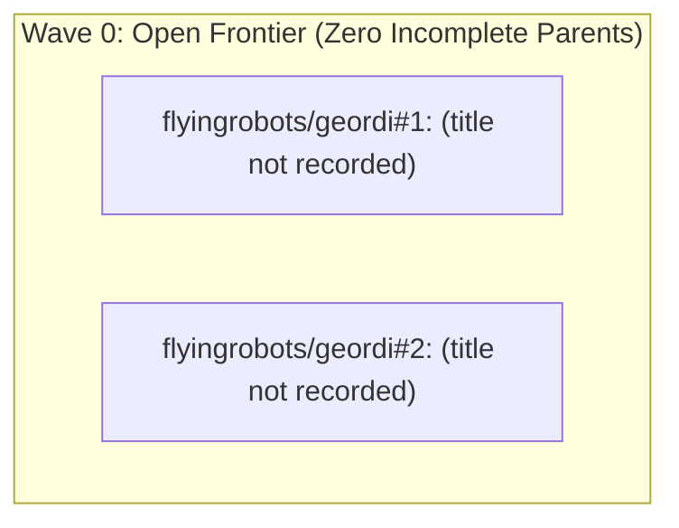

<!-- BEGIN GENERATED ISSUE DAG (taskalisk --emit-roadmap; do not edit by hand) -->

Compiled from issue frontmatter (`issue-dag/2`), home `flyingrobots/geordi`, roots `all open home issues`. Artifact hash `5558c8a2f8929b75`. Regenerate with `taskalisk.py --from-github [--root <ref>] --emit-roadmap`.

## DAG Structural Health

| Metric | Value |
| --- | --- |
| Open nodes | 2 |
| Reduced edges (raw) | 0 (0) |
| Edge density | 0.0 (outside band 0.01–0.50) |
| Max parallel width | 2 |
| Critical path (1) | flyingrobots/geordi#2 |
| Isolated nodes | 2 |
| Containers excluded | none |

## Ranked Open Frontier (Wave 0)

| Rank | Score | Issue | Title | Status | Unblocks | Depth | Resources | Directly unlocks |
| ---: | ---: | --- | --- | --- | ---: | ---: | --- | --- |
| 1 | 10 | [flyingrobots/geordi#1](https://github.com/flyingrobots/geordi/issues/1) | (title not recorded) | open | 0 | 1 | `host/docker/w/` | — |
| 2 | 10 | [flyingrobots/geordi#2](https://github.com/flyingrobots/geordi/issues/2) | (title not recorded) | open | 0 | 1 | `host/docker/w/cache` | — |

### Conflict-Free git-locks Batch

- [flyingrobots/geordi#1](https://github.com/flyingrobots/geordi/issues/1) (title not recorded) — `host/docker/w/`

## Task Checklist by Wave

### Wave 0

- [ ] [flyingrobots/geordi#1](https://github.com/flyingrobots/geordi/issues/1) (title not recorded) (open)
- [ ] [flyingrobots/geordi#2](https://github.com/flyingrobots/geordi/issues/2) (title not recorded) (open)

## Task Checklist by Workstream (`area:*`)

### feature

- [ ] [flyingrobots/geordi#1](https://github.com/flyingrobots/geordi/issues/1) (title not recorded)
- [ ] [flyingrobots/geordi#2](https://github.com/flyingrobots/geordi/issues/2) (title not recorded)

## Transitively-Reduced Dependency DAG

## Prerequisite Edge Accounting

| Blocker | Blocked | Evidence |
| --- | --- | --- |

<!-- END GENERATED ISSUE DAG -->